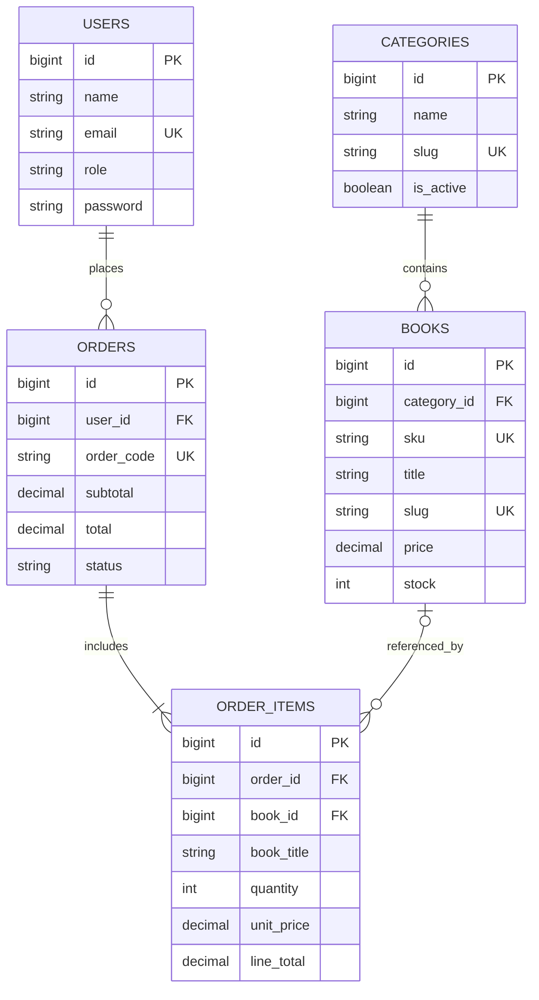

# ERD – BookNest

`orders.user_id` cho phép NULL để lưu đơn khách vãng lai nếu nghiệp vụ cho phép; trong luồng checkout hiện tại người dùng cần đăng nhập. `order_items.book_id` cho phép NULL để giữ lịch sử đơn nếu sách bị xóa.
